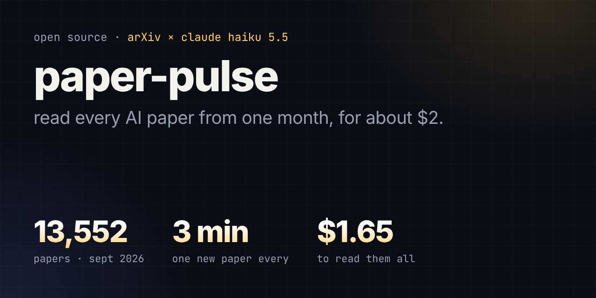
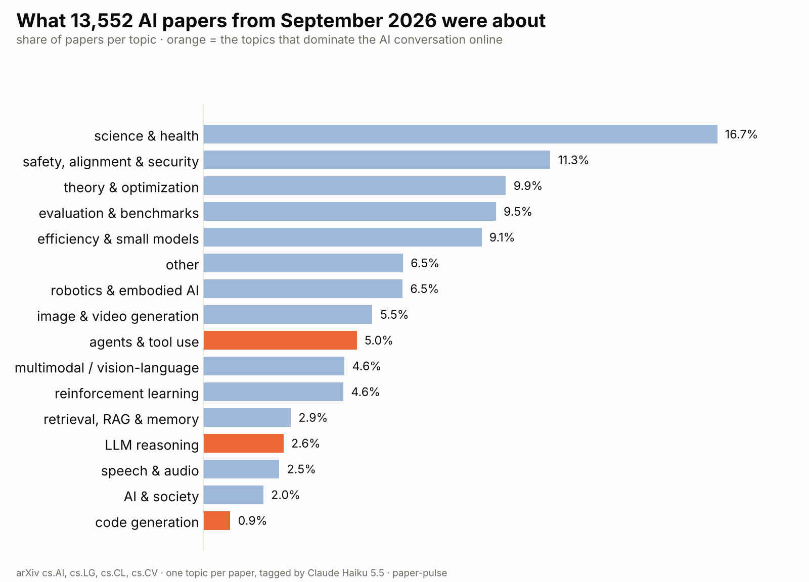

# paper-pulse

**Read every AI paper on arXiv from one month, for about $2.**

A small open-source tool that downloads every new AI paper from arXiv for a month, has a cheap model (Claude Haiku 5.5) read each abstract, and turns the result into a short report: what researchers are working on, when they publish, and which papers are worth a look.



## September 2026, in numbers

| | |
|---|---|
| papers read | **13,552** |
| a new paper every | **3.2 minutes** |
| time to read them all | **45 minutes** |
| cost | **$1.65** |

**What researchers actually wrote about:** science & health applications was the biggest topic (16.7% of papers). Agents were 5.0%, LLM reasoning 2.6% and code generation 0.9%.

**When they wrote:** about 430 papers on a normal weekday, about 210 on a weekend, and 1,090 on Monday 28 September, right after the ICLR 2027 deadline.

Full report with charts and the most surprising papers: [reports/2026-09/report.md](reports/2026-09/report.md)



## Why I built this

About 430 new AI papers come out every weekday. Miss two days and you're 860 papers behind. I couldn't keep up, so I built something that reads them for me.

## Run it yourself

You need Python 3 and an [OpenRouter](https://openrouter.ai) key. The tagging script needs no extra installs.

```bash
# 1. set your key (give it a credit limit, e.g. $5, on openrouter.ai/keys)
export OPENROUTER_API_KEY="your-key"        # Windows: set OPENROUTER_API_KEY=your-key

# 2. try 50 papers first (a few seconds, under 1 cent)
python3 paper_pulse.py --test

# 3. a whole month (default is last month)
python3 paper_pulse.py --month 2026-09

# 4. the report (needs matplotlib for the charts: pip install -r requirements.txt)
python3 make_report.py papers_tagged_2026-09.csv
```

You get `reports/2026-09/` with `report.md`, two charts and `tags.csv`.

### Built to survive a long run

- **Stop any time.** Ctrl+C, a closed laptop or a dropped connection loses nothing. Run the same command again and it only does the papers that are left.
- **Never pays twice.** Every tagged paper is saved the moment it's done.
- **Budget guard.** It stops itself before spending more than `--budget` dollars (default $4.50).
- **Checks arXiv's work.** It downloads one day at a time and compares what it got with what arXiv says exists, retrying when arXiv returns an empty page by mistake.
- **Cleans the model's answers.** Unknown topics become "other", scores are kept between 1 and 5, and empty or broken replies are retried.

## How it works

1. **Fetch.** The [arXiv API](https://info.arxiv.org/help/api/index.html) returns every paper in `cs.AI`, `cs.LG`, `cs.CL` and `cs.CV` submitted that month, one day at a time, 3 seconds between requests as arXiv asks.
2. **Tag.** Claude Haiku 5.5 reads each title and abstract and returns one topic from a fixed list of 16, a plain-English one-liner (15 words max), and a 1-5 "surprise" score: how surprising a smart non-expert would find it.
3. **Report.** `make_report.py` counts topics and days, draws the charts, and lists the papers that scored 5/5.

Each paper costs about $0.0001 (roughly 860 tokens in, 70 out).

## Honest limitations

- **One topic per paper.** A paper on reasoning benchmarks counts under only one of the two, so small topics may be undercounted.
- **Abstracts only.** The model reads the abstract, not the full paper, and it can be wrong. In a hand check of 50 random papers, all 50 one-liners were correct; of the 46 topics clear enough to judge, 45 were right (4 were too close to call).
- **"Surprise" is a fun filter, not a quality score.**
- **arXiv is not all of AI research**, and preprints are not peer reviewed.

## What's in this repo

```
paper_pulse.py          fetch + tag one month (no dependencies)
make_report.py          report, charts and tags.csv from a tagged month
reports/2026-09/        the September 2026 report
assets/banner.png
```

`tags.csv` has each paper's arXiv ID, link, date, topic, one-liner and score. It leaves out titles and abstracts on purpose, so the links take you to arXiv for the original.

## Roadmap

- a new report every month, with what rose and what faded since the month before
- an option to pick your own arXiv categories and topics

## Credits

Thank you to arXiv for use of its open access interoperability.

Made by [Sneha Deshmukh](https://www.linkedin.com/in/snehaadeshmukh/). MIT licensed.
