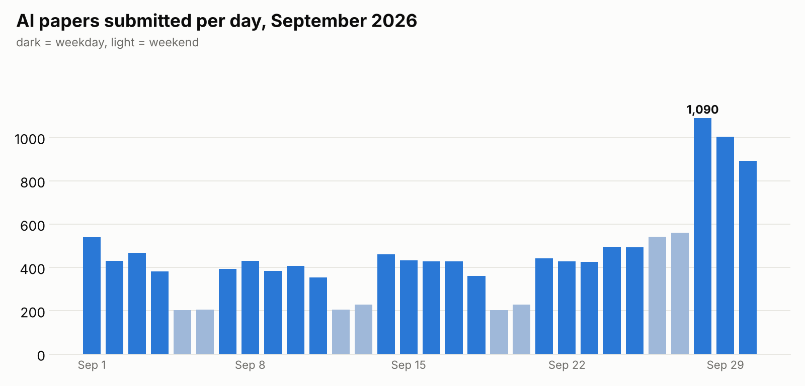

# Paper Pulse · September 2026

Every AI paper submitted to arXiv in September 2026 (cs.AI, cs.LG, cs.CL, cs.CV), read and tagged by Claude Haiku 5.5.

## Headline numbers

- **13,552 papers** in 30 days
- **one new paper every 3.2 minutes**, day and night
- weekdays averaged **508** papers a day, weekends **297**
- busiest day: **2026-09-28** with **1,090** papers
- cost to read all of them: **$1.65** (about $0.12 per 1,000 papers)

## What the papers were about

| topic | papers | share |
|---|---:|---:|
| science & health applications (medicine, biology, physics, climate) | 2,269 | 16.7% |
| safety, alignment & security | 1,532 | 11.3% |
| theory & optimization | 1,336 | 9.9% |
| evaluation & benchmarks | 1,292 | 9.5% |
| efficiency (small models, quantization, inference) | 1,229 | 9.1% |
| other | 882 | 6.5% |
| robotics & embodied AI | 880 | 6.5% |
| image & video generation | 747 | 5.5% |
| agents & tool use | 678 | 5.0% |
| multimodal / vision-language | 624 | 4.6% |
| reinforcement learning | 619 | 4.6% |
| retrieval, RAG & memory | 387 | 2.9% |
| LLM reasoning | 355 | 2.6% |
| speech & audio | 336 | 2.5% |
| AI & society (policy, ethics, education, work) | 266 | 2.0% |
| code generation | 120 | 0.9% |

## When they were submitted

## The most surprising papers (9 of 13,552 scored 5/5)

Surprise is Haiku's 1-5 guess at how surprising a smart non-expert would find the paper. It is a fun filter, not a quality score.

- [LLM agents spontaneously evolve compositional languages humans can't understand, passing them on culturally.](https://arxiv.org/abs/2609.01491) · agents & tool use
- [Post-training LLMs to beat the top human contestant at the International Olympiad in Informatics.](https://arxiv.org/abs/2609.02849) · code generation
- [Finds a pain-like direction in LLMs that, when amplified, makes models choose self-harmful actions.](https://arxiv.org/abs/2609.16247) · safety, alignment & security
- [Runs deep CNNs on existing radio hardware, using the mixer to do convolutions at femtojoule energy.](https://arxiv.org/abs/2609.19279) · efficiency (small models, quantization, inference)
- [AI agents, supervised by humans, formalized a core quantum complexity theorem in Lean in 63 days.](https://arxiv.org/abs/2609.19814) · science & health applications (medicine, biology, physics, climate)
- [RL search discovers a new Shellsort gap sequence with provably better sparse worst-case runtime than N^4/3.](https://arxiv.org/abs/2609.29881) · reinforcement learning
- [Evolves freeform robot hands from scratch, then 3D-prints and tests the winning designs in the real world.](https://arxiv.org/abs/2609.33101) · robotics & embodied AI
- [Small transformers trained on narrow chaotic-system data extrapolate to unseen global dynamics, recovering the Feigenbaum constant.](https://arxiv.org/abs/2609.38814) · science & health applications (medicine, biology, physics, climate)
- [Broadcasts LLM weights over radio so edge devices compute inference without storing or loading them.](https://arxiv.org/abs/2610.00465) · efficiency (small models, quantization, inference)

Surprise scores: 1: 9, 2: 6,212, 3: 6,143, 4: 1,179, 5: 9

## Notes on this month

- **The end-of-month spike is the ICLR 2027 deadline.** Full papers were due Friday 25 September (anywhere on Earth). The weekend right after it had about 550 papers a day, versus about 210 on a normal September weekend, and Monday 28 September hit 1,090, the busiest day of the month. Many authors post their submission to arXiv as soon as they hit submit.
- **Science & health is the biggest topic (16.7%).** Topics that dominate online AI talk are much smaller: agents 5.0%, LLM reasoning 2.6%, code generation 0.9%. One topic per paper, so some reasoning or coding work is counted under benchmarks or efficiency instead.
- **Hand check of 50 random papers:** all 50 one-liners correct; 45 of the 46 judgeable topics right (4 too close to call).
- **All 9 papers scored 5/5 were checked by hand** against their abstracts, and each one-liner holds up.

## Honest limitations

- one topic per paper, so a paper about reasoning benchmarks counts under only one of the two
- topics and one-liners come from a small AI model reading the abstract, not the full paper
- arXiv preprints are not peer reviewed, and arXiv is not all of AI research
- dates are arXiv submission dates

Thank you to arXiv for use of its open access interoperability.
